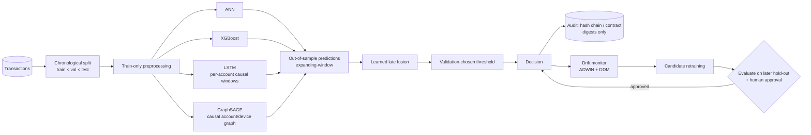

# Adversarially Robust, Blockchain-Audited Fraud Detection in Banking

**A multi-model architecture and leakage-safe evaluation framework**


> **Honest-reporting notice.** All *new* experiments in this repository were run on **synthetic data**, because the
> Kaggle dataset is not committed (and was not obtainable where the extension was built). They validate the *methods and
> evaluation protocol*, not real-bank performance. Several results are **negative** and are reported as such.
> Every output file records its data origin (`SYNTHETIC`, `KAGGLE_REAL` or `USER_CSV`).

---

## Table of contents
1. [Abstract](#1-abstract)
2. [Research questions and contributions](#2-research-questions-and-contributions)
3. [System architecture](#3-system-architecture)
4. [Methodology](#4-methodology)
5. [Experimental protocol](#5-experimental-protocol)
6. [Results](#6-results)
7. [Threats to validity and limitations](#7-threats-to-validity-and-limitations)
8. [Reproducing the work](#8-reproducing-the-work)
9. [Repository structure](#9-repository-structure)
10. [Testing and verification](#10-testing-and-verification)
11. [Security and privacy](#11-security-and-privacy)
12. [Roadmap](#12-roadmap)
13. [References](#13-references)
14. [Citation and license](#14-citation-and-license)

---

## 1. Abstract

Card-fraud detection is a heavily imbalanced, adversarial and non-stationary problem, and audit requirements
make model decisions legally sensitive. This project implements and evaluates a multi-model fraud-detection pipeline
(ANN, XGBoost, LSTM, GraphSAGE and a learned late-fusion ensemble) together with transfer learning, gradient-based
adversarial robustness testing (FGSM, PGD, adversarial training), post-hoc explainability (SHAP, LIME), sequential
concept-drift monitoring (ADWIN, DDM) with a safe candidate-retraining workflow, and a tamper-evident audit trail
(local hash chain plus a Solidity contract that stores only commitments).

The emphasis is on **scientific hygiene**: chronological splitting, train-only preprocessing, validation-only threshold
selection, causal sequence and graph construction, out-of-sample fusion training, imbalance-appropriate metrics, and a
claim-by-claim verification matrix generated from saved results. On synthetic data the project finds that transfer
learning gave no measurable benefit, learned fusion did not outperform the best single branch, and PGD adversarial
training improves robustness only near its training budget. These negative findings are part of the contribution.

## 2. Research questions and contributions

| # | Research question | Answer on synthetic data |
|---|---|---|
| RQ1 | Does a source-pretrained shared encoder improve fraud detection when target labels are scarce? | **No** measurable benefit (Section 6.1) |
| RQ2 | Does a learned late-fusion ensemble beat each individual branch? | **Not in this run** (Section 6.2) |
| RQ3 | Does PGD adversarial training yield robustness beyond its training budget? | **No**; gains are local to the training ε (Section 6.3) |
| RQ4 | Can ADWIN/DDM detect drift with delayed labels without touching the deployed model? | **Yes** on a controlled stream, with caveats (Section 6.4) |
| RQ5 | Can an audit log be made tamper-evident without storing raw data on-chain? | **Yes**, with documented limits (Section 6.5) |

**Contributions**
- A reproducible, CPU-friendly research framework (`fraudlab/`) with a labelled synthetic transaction generator that has
  account/device identifiers, per-account sequences, two schemas sharing a latent fraud signal, and optional drift.
- A schema-aware transfer-learning design: per-domain adapters plus canonical features, transferring only a shared encoder.
- Causal LSTM and GraphSAGE branches with runtime assertions that no window or edge reaches into the future.
- White-box FGSM/PGD with L∞ budgets, training-range feature bounds, immutable-feature protection and per-feature budgets.
- ADWIN and DDM drift monitoring, a prequential protocol with delayed labels, and a file-based model registry that never
  auto-promotes a retrained candidate.
- A tamper-evident hash chain and an improved Solidity contract, both tested.
- `PAPER_CLAIMS_MATRIX.md`, generated from result files, mapping each claim to implementation, procedure, artifact,
  verification status and limitations.

## 3. System architecture



Pre-existing components (ANN, five-model benchmark, FGSM, SHAP-for-XGBoost, hash chain, six-plus-tab Streamlit dashboard)
were preserved; the extension adds the modules above and four dashboard tabs.

## 4. Methodology

### 4.1 Data
- **Kaggle Credit Card Fraud** (Dal Pozzolo et al.): 284,807 transactions, 492 frauds (0.172 %), anonymised PCA features
  V1–V28, `Time`, `Amount`. **Not committed**; place `creditcard.csv` in `data/` to use it. It contains **no** account,
  device or merchant identifiers, so a genuine fraud graph and per-account sequences cannot be built from it, and the code
  refuses to fabricate one.
- **Synthetic generator** (`fraudlab/synthetic.py`): deterministic, labelled `is_synthetic=True`. Fraud arrives as account
  compromise bursts and isolated events; ring devices are shared across accounts; two domains (a Kaggle-like *target* and a
  differently-shaped *source*) share a latent fraud signal; an optional drift point moves the signal.

### 4.2 Leakage controls
| Stage | Control |
|---|---|
| Splitting | Chronological 60/20/20; ordering asserted; each split must contain both classes |
| Preprocessing | `FeaturePreprocessor` fitted on training rows only; raw elapsed time excluded (it extrapolates under a chronological split); cyclic hour-of-day and log-amount added |
| Early stopping & thresholds | Validation split only (max-F1); test labels used once for reporting |
| Sequences | Window for row *i* holds only same-account rows with time ≤ *tᵢ*; labels never used as inputs |
| Graph | Edges point only to earlier transactions sharing an account or device; only features (never labels) are aggregated |
| Fusion | Meta-learner trained **only** on out-of-sample base predictions from expanding-window folds |
| Adversarial | Bounds derived from training data; adversarial training uses the training split only |
| Drift | Detectors receive a label only after a configurable delay; the deployed model is never modified automatically |

### 4.3 Models
- **ANN** – 64-32-16-1 dense network, class-weighted (the original project's topology).
- **XGBoost** – gradient-boosted trees, independently evaluated branch.
- **LSTM** – 8-step causal per-account windows with a time-gap channel.
- **GraphSAGE** – two-layer mean-aggregator GraphSAGE with neighbour sampling (Hamilton et al., 2017).
- **Late fusion** – logistic regression on the logits of the four branches.

### 4.4 Transfer learning
Each domain has its own Dense **adapter** mapping its feature schema into a common space; three semantically identical
*canonical* features (log-amount, hour-sin, hour-cos) bypass the adapter. Only the **shared encoder** is transferred.
Fine-tuning is two-stage: (1) adapter and head with the encoder frozen, (2) full fine-tuning at a lower learning rate.
Arms: *scratch*, *transfer* and an *XGBoost* context baseline, using 10 %, 25 %, 50 % and 100 % of target training labels
and three seeds.

### 4.5 Adversarial robustness
FGSM and PGD (random start, step size 2.5ε/steps) under an L∞ budget in standardised feature space, clipped to the training
range **without moving clean points that already lie outside it**, with immutable features (hour-of-day) held fixed.
Baselines: random-sign noise of equal budget and a transfer attack from the ANN onto XGBoost. Adversarial training is
Madry-style (fresh PGD examples each epoch, clean + adversarial batches, clean-validation model selection).
> Perturbing anonymised PCA components is a **mathematical robustness test**, not a physically realisable transaction edit.

### 4.6 Explainability
SHAP TreeExplainer on XGBoost (additivity is unit-tested) and LIME tabular explanations on correctly flagged frauds, with
top-5 SHAP/LIME overlap as a consistency check. Explanations describe the *model*, not causal mechanisms.

### 4.7 Drift and safe retraining
`ADWIN` (adaptive window, Hoeffding-style bound) and `DDM` (Gama et al.) are implemented in `fraudlab/drift.py`; ADWIN is
cross-checked against the `river` library in the tests. On the first post-drift alarm a candidate is trained on labels that
have already arrived, evaluated on a strictly later hold-out, and **only recommended**. `ModelRegistry.promote()` requires
explicit approval and a passing evaluation, preserves old versions and supports rollback.

### 4.8 Audit trail
`audit_chain.py` implements a SHA-256 hash chain whose verifier reports the first bad block and reason (modification,
deletion, insertion, reordering, invalid hash/genesis). Records carry a salted **payload digest** instead of raw data.
`contracts/FraudAudit.sol` stores digests, decision, risk score in basis points (≤ 10,000) and a model-version hash, chains
each entry into an on-chain head hash, uses custom errors, bounds checks and two-step ownership transfer.

## 5. Experimental protocol

- **Metrics:** precision, recall, F1, PR-AUC (primary), ROC-AUC, MCC and the confusion matrix. Accuracy is not a headline
  metric at ~0.17–2 % fraud prevalence.
- **Seeds:** transfer uses seeds 0–2 (mean ± std reported); fusion, robustness and drift use a single seed.
- **Statistics:** no p-values are reported; with so few seeds and ~60 test frauds they would be misleading.
- **Environment (verified):** Linux, Python 3.12, 1 CPU / 3 GB RAM, TensorFlow-CPU 2.21, Keras 3.15, scikit-learn 1.8,
  XGBoost 3.4, SHAP 0.54, LIME 0.2, Hardhat 2.x. Windows commands are provided but were **not executed on Windows**.

## 6. Results

*All numbers below are synthetic-data results from files in `artifacts/research/`. Regenerate them with the commands in
Section 8 (small numeric differences across machines are expected).*

### 6.1 Transfer learning (RQ1)
Paired difference in test PR-AUC, *transfer − scratch*, mean over 3 seeds:

| Target labels | 10 % | 25 % | 50 % | 100 % |
|---|---|---|---|---|
| ΔPR-AUC | −0.080 | −0.023 | +0.001 | −0.011 |

The pretrained encoder does work on its own source domain (held-out PR-AUC 0.75), so the pipeline is functional; the
adapter-based alignment did not help the target task. XGBoost matched or beat both neural arms. A plausible but **untested**
explanation is that a freshly initialised target adapter cannot discover the alignment from only a handful of frauds.

### 6.2 Multi-model branches and fusion (RQ2)
| Model | Test PR-AUC |
|---|---|
| GraphSAGE | 0.740 |
| LSTM | 0.693 |
| **Learned late fusion** | **0.691** |
| Simple average | 0.677 |
| ANN | 0.622 |
| XGBoost | 0.593 |

Fusion did not beat the best branch (GraphSAGE). The graph and sequence branches benefit from entity structure that exists
only because the synthetic generator creates it; this says nothing about real data. One seed, ~60 test frauds.

### 6.3 Adversarial robustness (RQ3)
| PR-AUC under PGD | ε = 0.1 | ε = 0.3 |
|---|---|---|
| Standard ANN | 0.375 | 0.050 |
| PGD-adversarially-trained ANN | 0.428 | 0.067 |

Adversarial training helps near its training budget but both models collapse at larger ε. **No general robustness is claimed.**
All attacks pass automated checks for budget, feature bounds and immutable features.

### 6.4 Concept drift (RQ4)
On a synthetic stream with a known drift point and a 100-transaction label delay, ADWIN alarmed 597 and DDM 445 transactions
after the drift. DDM also raised 2 alarms *before* the drift (a known sensitivity). The candidate model was evaluated and
recommended but **not** deployed. Single stream, single seed.

### 6.5 Audit integrity (RQ5)
62/62 Python tests and 9/9 Solidity tests pass. Tamper tests cover modified, deleted, inserted, reordered, invalid-hash,
truncated and fully rewritten chains. A bare hash chain **cannot** detect tail truncation or a full recompute-and-rewrite
without an external anchor (`head_anchor()` / the contract's `headHash`); the tests demonstrate both the limitation and the
anchored fix. **No public-testnet deployment was performed.**

### 6.6 Pre-existing Kaggle results
`artifacts/model_comparison.csv` and `artifacts/metrics.json` are internally consistent (precision/recall recompute from
TP/FP/FN) and the saved models load, but they were produced with a random split and a fixed 0.5 threshold and **could not
be reproduced** here. An earlier README table (ANN 99.05 % / 84.60 % FGSM accuracy) matched no committed artifact and was removed.

## 7. Threats to validity and limitations

- **Synthetic data:** structure is generated, so absolute numbers and branch rankings do not transfer to real banks.
- **Small samples:** ~60 test frauds and one seed for fusion/robustness/drift; differences of a few PR-AUC points are within noise.
- **Transfer:** only synthetic source/target pairs were tested; real cross-institution transfer is untested.
- **Original pipeline:** random split and fixed threshold; `adversarial_test.py` uses a validation tail made of perturbed training rows (leaky model selection). Documented in `IMPLEMENTATION_AUDIT.md`, left unchanged.
- **Attacks:** white-box, specific budgets/models; anonymised features limit realism.
- **Drift:** simplified ADWIN; DDM false alarms; single stream.
- **Audit:** no external contract audit; local EVM only.
- **Dataset licence:** `artifacts/gnn_reference.npz` contains standardised Kaggle rows; check the licence before redistributing.
- **Paper claims:** the paper text was not available; `PAPER_CLAIMS_MATRIX.md` was derived from its title and the project brief.

## 8. Reproducing the work

### Windows 11 PowerShell
```powershell
py -3.12 -m venv .venv
.\.venv\Scripts\Activate.ps1          # if blocked: Set-ExecutionPolicy -Scope Process Bypass
python -m pip install --upgrade pip
pip install -r requirements-dev.txt

python -m pytest -q                    # expect: 62 passed

$env:TF_CPP_MIN_LOG_LEVEL = "3"
python transfer_learning.py --quick        # drop --quick for full size
python adversarial_research.py --quick
python train_multimodel.py --quick
python explain_research.py --synthetic --n 12000 --n-explain 6
python drift_demo.py
python build_claims_report.py              # regenerates PAPER_CLAIMS_MATRIX.md

python -m streamlit run app.py             # http://localhost:8501
```
One-shot alternatives: `.\scripts\quickstart.ps1` and `.\scripts\full_run.ps1` (full run ≈ 20–30 min on a laptop CPU).

### Optional
```powershell
# Original Kaggle pipeline: place creditcard.csv in data\ (never commit it)
python train_model.py; python model_comparison.py; python adversarial_test.py

# Real transfer needs a second dataset (time, amount, Class + numeric features; schemas may differ)
python transfer_learning.py --source-csv A.csv --target-csv B.csv

# Solidity tests (Node 18+), in-process EVM, no keys or network
npm install
npx hardhat test

# Local audit chain demo
python blockchain_demo.py --rows 5
```
The dashboard shows four research tabs without any dataset; with `data/creditcard.csv` and the original artifacts all
12 tabs appear. Dashboards only **load saved results**; they never retrain.

## 9. Repository structure

```
fraudlab/                 reusable library (synthetic, data, metrics, nn, adversarial, sequences, graph, fusion, drift, registry, explain)
transfer_learning.py      transfer-learning experiment
train_multimodel.py       ANN + XGBoost + LSTM + GraphSAGE + late fusion
adversarial_research.py   FGSM / PGD / PGD adversarial training
explain_research.py       SHAP + LIME
drift_demo.py             ADWIN / DDM + safe retraining workflow
audit_chain.py            tamper-evident hash chain (no TensorFlow needed)
contracts/                FraudAudit.sol and Hardhat tests
research_dashboard.py     research tabs for app.py
app.py                    Streamlit dashboard (original tabs + research tabs)
tests/                    pytest suite (62 tests)
artifacts/research/       saved metrics, plots, weights (all labelled with data origin)
train_model.py, model_comparison.py, adversarial_test.py, explainability.py, train_transfer.py, train_gnn.py   original pipeline (unchanged)
IMPLEMENTATION_AUDIT.md   initial-state audit and findings
PAPER_CLAIMS_MATRIX.md    claim -> implementation -> evidence -> status -> limitations
MODEL_CARD.md  REPRODUCIBILITY.md  SECURITY.md  START_HERE.md  PROGRESS.md
```

## 10. Testing and verification
- **pytest (62):** data/splitting/leakage, metrics, models, transfer plumbing (including a guard against the transfer arm
  reusing scratch predictions), causal sequences and graph, fusion out-of-sample ordering, FGSM/PGD constraints
  (including a regression test for out-of-range clean points), SHAP additivity, LIME, drift detectors, registry safeguards,
  audit tamper scenarios, saved-artifact provenance and a headless dashboard render.
- **Hardhat (9):** deployment, recording, independent off-chain hash recomputation, access control, input validation,
  out-of-range reads, record verification, immutability of the interface, two-step ownership.
- Bugs found during development and fixed are listed in `PROGRESS.md`.

## 11. Security and privacy
No credentials are needed; local hash-chain mode works offline. Only salted digests, decisions, scores and a model id are
audit-logged; raw transaction data stays off-chain (the legacy local chain still stores the label—drop it in production).
See `SECURITY.md`.

## 12. Roadmap
1. Replicate on real data: Kaggle (chronological split) and a second real dataset with entity ids for graph and transfer studies.
2. Multi-seed experiments with confidence intervals; stronger transfer methods (domain-adversarial alignment, multi-source pretraining).
3. Cost-sensitive thresholds and calibration; delayed-label evaluation closer to production.
4. Certified/adaptive robustness evaluation and realistic constrained attacks on interpretable features.
5. Anchor the audit head hash externally and test on a public testnet (not done).

## 13. References
- A. Dal Pozzolo, O. Caelen, R. A. Johnson, G. Bontempi. *Calibrating Probability with Undersampling for Unbalanced Classification.* IEEE CIDM, 2015. (Credit Card Fraud dataset source.)
- I. Goodfellow, J. Shlens, C. Szegedy. *Explaining and Harnessing Adversarial Examples.* ICLR, 2015. (FGSM)
- A. Madry et al. *Towards Deep Learning Models Resistant to Adversarial Attacks.* ICLR, 2018. (PGD)
- W. Hamilton, Z. Ying, J. Leskovec. *Inductive Representation Learning on Large Graphs.* NeurIPS, 2017. (GraphSAGE)
- S. Hochreiter, J. Schmidhuber. *Long Short-Term Memory.* Neural Computation, 1997.
- T. Chen, C. Guestrin. *XGBoost: A Scalable Tree Boosting System.* KDD, 2016.
- S. Lundberg, S.-I. Lee. *A Unified Approach to Interpreting Model Predictions.* NeurIPS, 2017. (SHAP)
- M. T. Ribeiro, S. Singh, C. Guestrin. *"Why Should I Trust You?": Explaining the Predictions of Any Classifier.* KDD, 2016. (LIME)
- A. Bifet, R. Gavaldà. *Learning from Time-Changing Data with Adaptive Windowing.* SIAM SDM, 2007. (ADWIN)
- J. Gama, P. Medas, G. Castillo, P. Rodrigues. *Learning with Drift Detection.* SBIA, 2004. (DDM)

## 14. Citation and license
If you use this code, please cite the repository and state that the reported results are on synthetic data:

```bibtex
@misc{fraud_detection_research_extension,
  title  = {Adversarially Robust, Blockchain-Audited Fraud Detection in Banking: A Multi-Model Architecture and Evaluation Framework},
  author = {Aditee and contributors},
  year   = {2026},
  url    = {https://github.com/Aditee26/fraud_detection},
  note   = {Research prototype; experiments on synthetic data}
}
```
**License:** add a `LICENSE` file of your choice (none is included yet). The Kaggle dataset has its own licence and is not
redistributed here.

> Research prototype for education and method comparison. **Not** validated for production, automated blocking or regulatory use.
